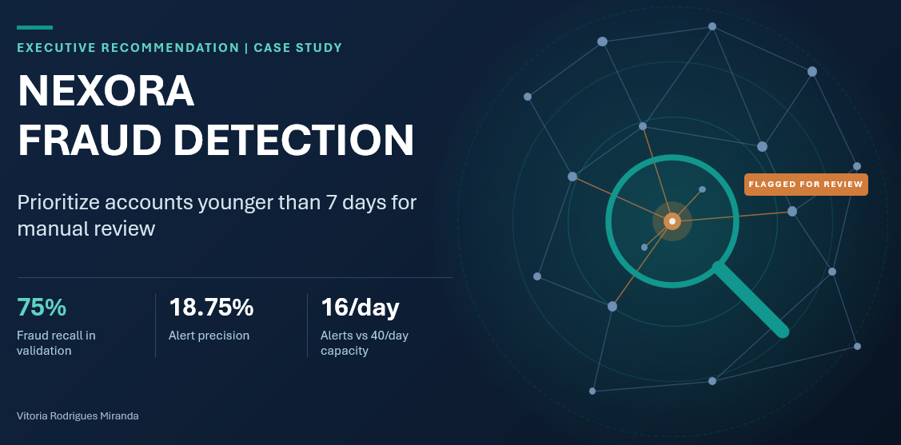
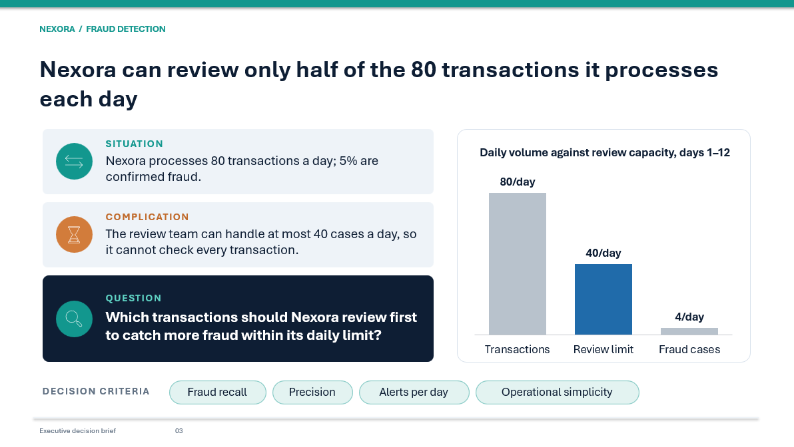
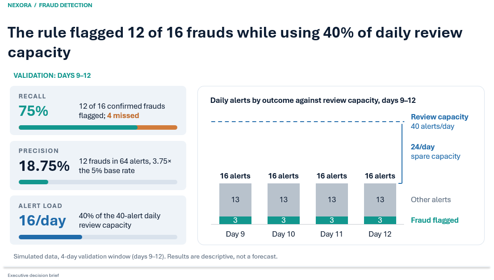
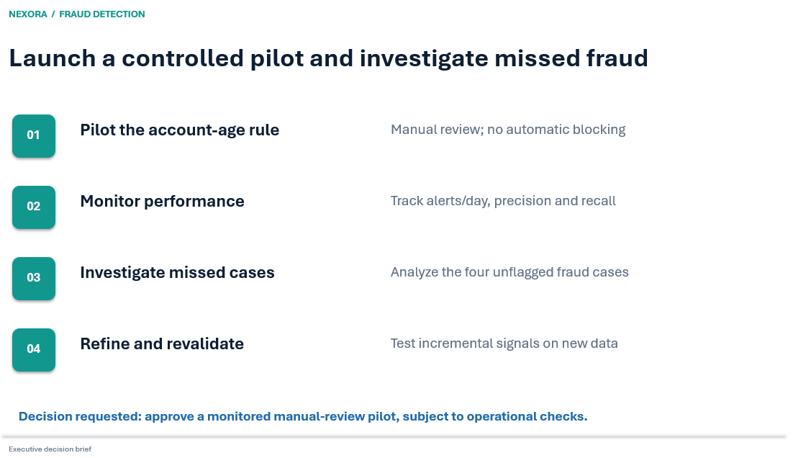

# Nexora Fraud Detection

An Excel-based case study on prioritizing transactions for manual fraud review. Nexora can review **up to 40 alerts per day**. The business question is which transactions to review first to catch fraud while staying within that limit.

**Quick links:** [Executive presentation (PDF)](presentation/Nexora_Fraud_Detection_Executive_Presentation.pdf) · [Interactive analysis (Google Sheets)](https://docs.google.com/spreadsheets/d/1ar3YrQjsrO1NUXPqPVcAdeN0y_QxKXvr/edit?usp=sharing) · [All project files](#project-files)

## Executive recommendation

Pilot a rule that flags a transaction for manual review when the account is **less than seven days old**. In the simulated validation period, the rule flagged **12 of 16 confirmed fraud cases** and generated **16 alerts on each of the four days**, using 40% of daily review capacity.

## Business problem

Nexora processes 80 transactions a day, and 5% are confirmed fraud. Reviewing every transaction would take twice the team's daily capacity, so the review queue has to be prioritized. I compared options on recall, precision, alerts per day, and operational simplicity.

## Data and methodology

The dataset contains **960 simulated transactions across 12 days**. Each row represents one transaction and includes a transaction ID, account ID, device ID, transaction timing, amount, account age, and confirmed fraud status.

I defined the review constraint, developed hypotheses, explored **days 1–8 (640 transactions)**, and evaluated the account-age rule on **days 9–12 (320 transactions)**. I used descriptive statistics and compared fraud rates within account-age groups. Device signals used only transactions recorded before the one being evaluated. Confirmed fraud status was used to measure results after the fact.

| Signal tested | Finding | Decision |
|---|---|---|
| Account age under 7 days | The fraud rate was **18.75%** for newer accounts and **1.56%** for accounts aged 7 days or more in both periods. | Pilot the rule. |
| Prior device sharing across accounts | Among accounts aged 7 days or more, the signal flagged all **256 validation transactions**, including all **4 frauds** missed by the age rule. That would add **64 alerts per day**, for a total of 80 against a limit of 40. | Defer as a standalone add-on. |
| Prior transaction on the same device within 30 minutes | Among accounts aged 7 days or more, the signal generated **zero additional alerts** in validation. | Defer the 30-minute rule. |

## Validation results

| Metric | Calculation | Result |
|---|---|---:|
| Precision | Confirmed frauds flagged ÷ all alerts | 12 ÷ 64 = **18.75%** |
| Recall | Confirmed frauds flagged ÷ all confirmed frauds | 12 ÷ 16 = **75%** |
| Baseline fraud rate | All confirmed frauds ÷ all transactions | 16 ÷ 320 = **5%** |
| Daily review volume | Alerts on each validation day | **16 of 40 slots** |
| Review outcomes | 64 alerts − 12 confirmed frauds flagged | **52 legitimate transactions flagged** |
| Missed fraud | 16 confirmed frauds − 12 flagged | **4 transactions** |

The rule raised the concentration of confirmed fraud in the review queue from 5% to 18.75%, a **3.75× lift** over the validation baseline. The queue still contained 52 legitimate transactions, and four frauds remained outside it.

## Pilot and limitations

Use the rule for manual review only, with no automatic blocking. Track daily alert volume, precision, and recall as outcomes become available. Investigate the four missed cases and test any additional rule on a new period before expanding the queue.

The results describe a four-day holdout from simulated data. A live pilot would be needed to measure real-world performance, review costs, and prevented losses.

## Project files

| Resource | Description | Access |
|---|---|---|
| 📑 **Executive presentation** | Findings, recommendation, and next steps. | [View PDF](presentation/Nexora_Fraud_Detection_Executive_Presentation.pdf) · [Download PowerPoint](presentation/Nexora_Fraud_Detection_Executive_Presentation.pptx) |
| 📊 **Interactive analysis** | Browser version of the workbook, with calculations and transaction-level data. | [Open Google Sheets](https://docs.google.com/spreadsheets/d/1ar3YrQjsrO1NUXPqPVcAdeN0y_QxKXvr/edit?usp=sharing) |
| 📈 **Excel workbook** | Calculations and supporting analysis. | [Download Excel](analysis/Nexora_Fraud_Validation.xlsx) |
| 🗂️ **Raw dataset** | Original synthetic transaction data. | [View dataset](data/nexora_fraude_fictitious.csv) |

> **Note:** The dataset is synthetic and intended for portfolio and educational purposes. The Google Sheets version provides browser-based access; some Excel-specific features, such as PivotTables, may behave differently.
